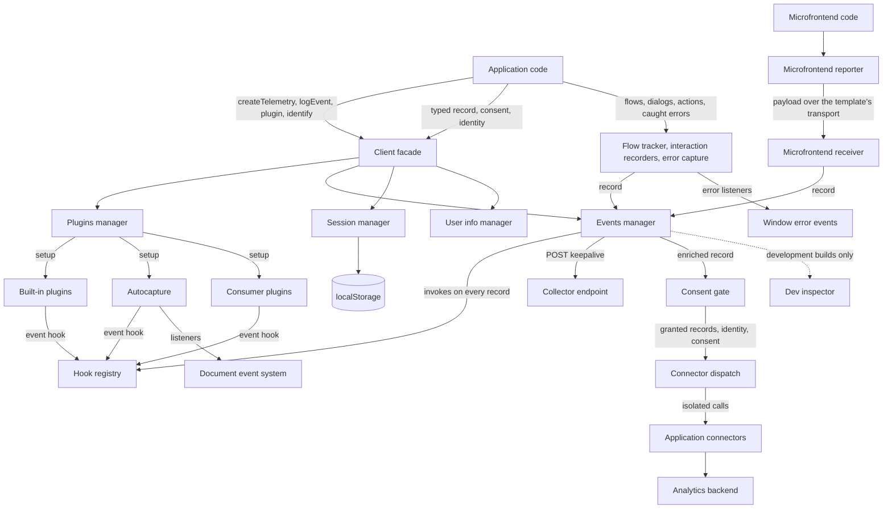
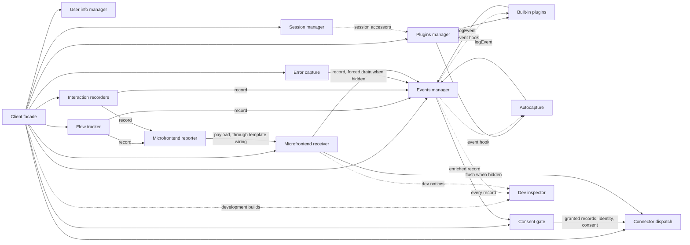
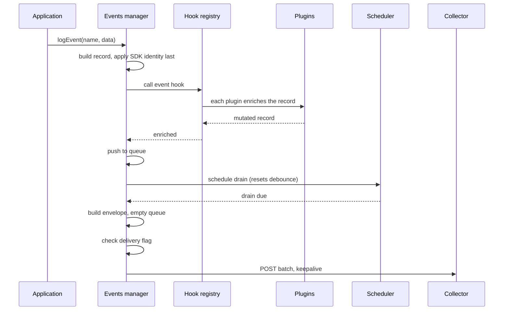
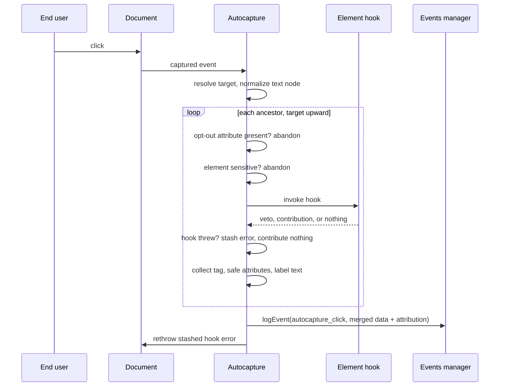
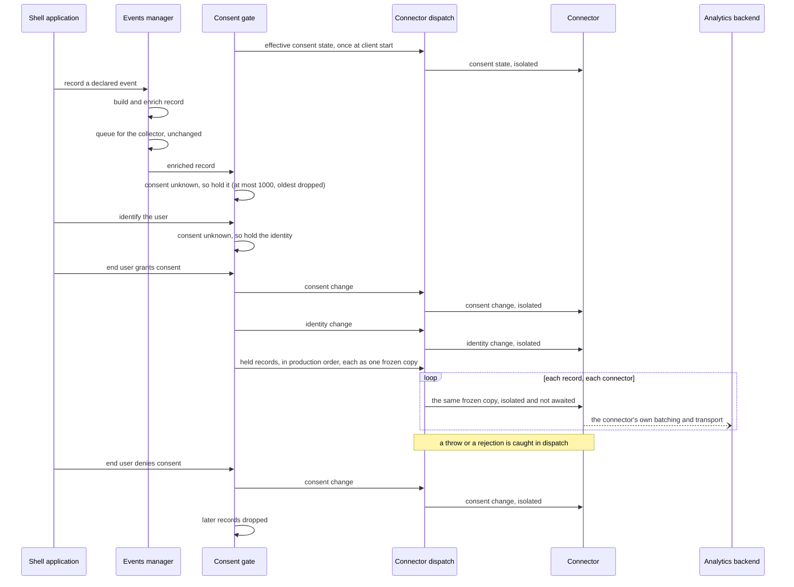
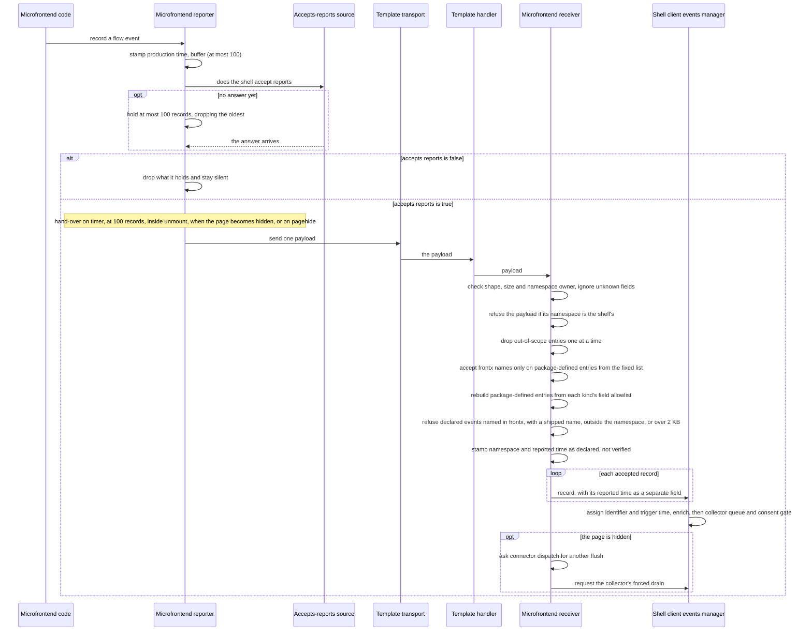
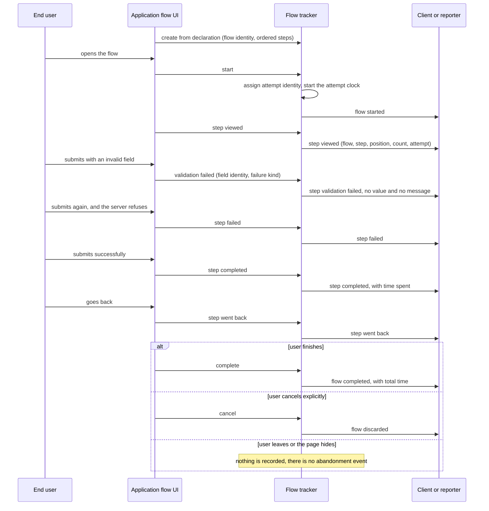
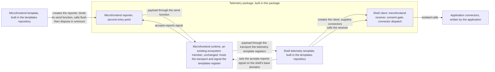

# Technical Design — Telemetry SDK

- [ ] `p3` - **ID**: `cpt-frontx-telemetry-design-telemetry-sdk`

<!-- toc -->

- [1. Architecture Overview](#1-architecture-overview)
  - [1.1 Architectural Vision](#11-architectural-vision)
  - [1.2 Architecture Drivers](#12-architecture-drivers)
  - [1.3 Architecture Layers](#13-architecture-layers)
- [2. Principles & Constraints](#2-principles--constraints)
  - [2.1 Design Principles](#21-design-principles)
  - [2.2 Constraints](#22-constraints)
- [3. Technical Architecture](#3-technical-architecture)
  - [3.1 Domain Model](#31-domain-model)
  - [3.2 Component Model](#32-component-model)
  - [3.3 API Contracts](#33-api-contracts)
  - [3.4 Internal Dependencies](#34-internal-dependencies)
  - [3.5 External Dependencies](#35-external-dependencies)
  - [3.6 Interactions & Sequences](#36-interactions--sequences)
  - [3.7 Database schemas & tables](#37-database-schemas--tables)
- [4. Additional context](#4-additional-context)
- [5. Traceability](#5-traceability)

<!-- /toc -->

## 1. Architecture Overview

### 1.1 Architectural Vision

The SDK is a closure-based composition rather than a class hierarchy. `createTelemetry` builds a context — normalized configuration, a hook registry and a logger — and hands the same context to four managers: events, session, user info and plugins. The client it returns is a small facade whose methods delegate to those managers. The main entry point exports the factory, the plugin helpers, the element-hook key, the recording surfaces for flows, dialogs, actions and errors, the report-payload schema, and the types, the connector contract among them. A second entry point exports the microfrontend reporter and nothing else. Nothing beyond those is exported, so the internal arrangement stays free to change.

The central decision is that **all context enrichment goes through one hook**. Session, device, navigation, application info, locale and autocapture are plugins, registered by the client's own start path using the same registration surface a consumer uses. The events manager knows nothing about any of them: it calls the `event` hook on every record before queueing it and lets whoever registered contribute. This keeps the enrichment surface honest — the SDK cannot give itself a capability it withholds from consumers, because it is a consumer of its own extension point.

Delivery is deliberately separated from collection. Records accumulate in an in-memory queue and a scheduler decides when to drain it, so the collection path is synchronous and cheap while the delivery path owns all the policy — batching, envelope construction, and the request. The two are joined only by the queue, which is what makes the collection guarantees hold even when delivery is suppressed or fails.

The design adds a second delivery path beside the collector without changing the first. After enrichment, a record goes both to the collector queue and to a consent gate. The gate passes records to connector dispatch while the user has granted consent, which calls every connector the application supplied. A connector is an object the application writes for its own analytics backend; the package calls it and knows nothing about what is behind it. Capture becomes declared: the application declares its events in a typed catalog, and flows, dialogs, key actions and errors are recorded through package-defined recorders rather than inferred from the page. Microfrontends report through a small reporter that hands batches to a receiver on the shell's client, and their records are then delivered through the shell's connectors, under the shell's consent and identity state. Connectors, consent and identity therefore exist in one place, the shell's client. The shipped behaviour that the decision record ([ADR/0001](./ADR/0001-declared-capture-connector-delivery.md)) retires stays in place, unchanged, until the change that retires it.

### 1.2 Architecture Drivers

Requirements that significantly influence architecture decisions.

**ADRs**: [ADR/0001-declared-capture-connector-delivery.md](./ADR/0001-declared-capture-connector-delivery.md)

#### Functional Drivers

| Requirement | Design Response |
|-------------|------------------|
| `cpt-frontx-telemetry-fr-client-creation` | `cpt-frontx-telemetry-component-client` normalizes configuration once at construction and guards every lifecycle method on the presence of `window`, so a server import yields a functioning object that collects nothing. |
| `cpt-frontx-telemetry-fr-client-lifecycle` | The client keeps one lifecycle state (created, started or destroyed), so a second start, or a start after teardown, is refused rather than silently duplicating hooks, and a second teardown does nothing; teardown orders session detach, plugin teardown hooks, then events-manager teardown so a parting event still reaches the queue before the final delivery, after which the events manager accepts no more records. The parts this design adds tear down after these steps, in the order `cpt-frontx-telemetry-component-client` gives. |
| `cpt-frontx-telemetry-fr-custom-events` | `cpt-frontx-telemetry-component-events-manager` builds each record with caller fields first and SDK identity last, so identity cannot be overridden, then invokes the enrichment hook before queueing. |
| `cpt-frontx-telemetry-fr-batched-delivery` | A scheduler owned by the events manager debounces the drain and is reset by each new record; a document visibility listener and the teardown path both force an immediate drain, and the request carries `keepalive`. |
| `cpt-frontx-telemetry-fr-collector-endpoint` | The events manager resolves the endpoint from normalized configuration only, and selects between two envelope builders on the configured envelope version. |
| `cpt-frontx-telemetry-fr-delivery-disable` | The drain builds the envelope and empties the queue before consulting the delivery flag, so suppressing delivery changes exactly one step and leaves collection behaviour identical. |
| `cpt-frontx-telemetry-fr-session-continuity` | `cpt-frontx-telemetry-component-session-manager` stores the session in browser storage and derives its continuation from observed activity on scroll, keypress and click, debounced so that activity bursts cost one write. |
| `cpt-frontx-telemetry-fr-device-identity` | Storage keys are derived from the configured infix, and the device identifier is read or minted through the same storage helpers the session uses, then contributed by a built-in plugin like any other field. |
| `cpt-frontx-telemetry-fr-builtin-context` | `cpt-frontx-telemetry-component-builtin-plugins` supplies session, device, navigation and application-info plugins, registered by the client at start through the ordinary plugin surface. |
| `cpt-frontx-telemetry-fr-locale-source` | The locale plugin holds a reference to the application's source and reads it inside the enrichment hook, so the value is resolved per record rather than captured at setup. |
| `cpt-frontx-telemetry-fr-plugin-registration` | `cpt-frontx-telemetry-component-plugins-manager` keys plugins by name, filters falsy entries at registration, and runs every setup during the client's start. |
| `cpt-frontx-telemetry-fr-element-attribution` | `cpt-frontx-telemetry-component-autocapture` reads a hook from each element on the ancestor walk through a cross-realm registry symbol, and merges contributions under a closest-hook-wins rule. |
| `cpt-frontx-telemetry-fr-dom-autocapture` | The autocapture plugin installs passive capture-phase document listeners for the three interaction types and builds a record from the ancestor walk. |
| `cpt-frontx-telemetry-fr-capture-opt-out` | The walk tests for presence of the opt-out attribute on every ancestor and abandons the event on the first one found, without reading the attribute's value. |
| `cpt-frontx-telemetry-fr-redaction` | The walk consults element-sensitivity and value-safety predicates before recording anything: a sensitive element abandons the whole event, while a value-safety rejection suppresses only the offending field and lets the rest of the event proceed. |
| `cpt-frontx-telemetry-fr-independent-publication` | The package declares its own version, a single entry point built to both module formats, and a published-file allowlist that admits the distribution, readme, license and notice while excluding the demo. The microfrontend reporter adds a second entry point, also built to both module formats. The main entry is also built twice: a `development` export condition resolves to a build with the dev inspector and the development notices, and the default condition resolves to a build without them. |
| `cpt-frontx-telemetry-fr-connectors` | `cpt-frontx-telemetry-component-connector-dispatch` holds the connectors supplied at client construction and calls each of them for every record the consent gate passes, synchronously. Every record carries the time it was produced, so a backend can order records whatever order they arrive in. A shell record's trigger time is set when the record is made. A microfrontend record carries the time the reporter assigned, as the reported time beside the trigger time set on receipt. As the design's own choice, and not as a requirement, dispatch hands records over in the order they reach the shell's client, and held records in the order they were produced. A microfrontend's records stay in their own order within and across its payloads. What happens after the call returns is the connector's business, which is what makes delivery best effort. Verified by a unit test that every record a test connector receives, from the shell and from a microfrontend, carries its production time. |
| `cpt-frontx-telemetry-fr-connector-mapping` | The connector contract, `cpt-frontx-telemetry-interface-connector`, is a set of optional handlers: one for a record, a measurement, an identity change (set or cleared), a consent change, a flush request and a shutdown request. Nothing calls the measurement handler until performance measurement, a p2 requirement, is designed. The package hands over its own typed records and never shapes them for a backend, so mapping, batching and transport all live in the connector, as `cpt-frontx-telemetry-constraint-no-backend-knowledge` requires. |
| `cpt-frontx-telemetry-fr-telemetry-states` | `cpt-frontx-telemetry-component-client` fixes the state at construction. The collector counts as a configured connector unless it is switched off. A new, additive configuration option switches it on or off. By default it is on only when the application supplies no connector, so shipped clients, which supply none, keep it on. When the application supplies connectors, the collector is off unless the application turns it on, and when the collector and application connectors are both active, a development notice says so. With the collector off, a record is not queued, drained or posted, whether or not connectors exist. The state comes from three exclusive cases. With no application connector and the collector off, the client is in the state without a connector. With the collector as the only connector and the delivery flag off, the client is outside the three states, in the shipped delivery-suppression mode. In every other case it is in the state with a connector. No telemetry means the shell creates no client, which is template wiring. In the state without a connector, a production build's start registers no plugins, installs no listeners and writes nothing to storage, so nothing is captured or stored, and recording calls return at once. The client exposes one value for microfrontends, accepts reports, by one rule: true in the state with a connector, in the delivery-suppression mode, and in development builds, and false otherwise. The shell sets the accepts-reports signal from that value, and a shell with no client sets it to false. The collector counts as a configured connector for these three states and for nothing else. The shipped delivery flag stays outside them. In the delivery-suppression mode the client behaves as shipped, so plugins register, records are enriched and the queue drains, but nothing is posted, and the development no-connector notice is not shown. Accepts reports is true in that mode too, because collection continues. With connectors the application supplies, the flag silences only the collector, and the client is in the state with a connector. The mode is verified by a unit test with the collector as the only connector and the flag off, asserting that records are enriched and drained, nothing is posted, accepts reports is true and no notice is shown. |
| `cpt-frontx-telemetry-fr-dev-visibility` | `cpt-frontx-telemetry-component-dev-inspector` shows each enriched record in the browser console, one grouped entry per record, keeps a bounded in-memory list that tests read through the record-list method, and in the state without a connector shows a notice that none is configured. The main entry is built twice. A `development` export condition resolves to a build with the dev inspector and the development notices, and the default condition resolves to a build without them. Bundlers that resolve the `development` condition in development get the first build: Vite does, so Vitest test runs count as development, and webpack 5 does too. Node and other resolvers get the production build. In the production build the record-list method still exists and returns an empty list, so the typed surface is the same in both builds. Verification: a production bundle of a sample consumer contains no inspector code, and a development build of that consumer shows the no-connector notice. |
| `cpt-frontx-telemetry-fr-declared-events` | The client takes the application's event catalog as a type parameter. Its typed record call accepts only declared names and their data shapes, so a wrong name or shape fails type-checking before the application runs. The shipped untyped `logEvent` keeps working unchanged. |
| `cpt-frontx-telemetry-fr-event-namespace` | An event name is a list of segments separated by a dot. Events the package defines use the reserved first segment `frontx`, which the catalog type refuses for declared names. Until the decision record retires them, the catalog type also refuses, as declared names, the names the shipped package records itself: `page_view`, `session_start`, and any name starting with `autocapture_`. A microfrontend's catalog type requires every name to start with that microfrontend's namespace. The shell's client is created with a namespace for the shell's own declared events, and the shell's catalog type requires its names to start with it. The report payload marks each entry as a package-defined record or a declared event, and `cpt-frontx-telemetry-component-mfe-receiver` checks these rules again at runtime: it accepts `frontx` names only for package-defined records and only from a fixed list, the flow, dialog, action and error events, refuses a declared event whose name is in `frontx`, is a shipped record name or is outside the payload's namespace, and refuses a payload whose namespace equals the shell's. It keeps one entry identity per namespace, so a second microfrontend claiming a taken namespace is refused, while a remount with the same entry identity is accepted. |
| `cpt-frontx-telemetry-fr-flow-declaration` | `cpt-frontx-telemetry-component-flow-tracker` is created from a declaration: a stable flow identity and an ordered list of steps, with a form declared as a one-step flow. The tracker only observes; presenting steps and moving between them stay with the application. |
| `cpt-frontx-telemetry-fr-flow-events` | The flow tracker assigns the attempt identity when the flow starts, times each step and the whole attempt on a monotonic clock, and records the eight flow events with flow, step, step position, step count and attempt identity. Step validation failed takes a field identity and a failure kind only; it has no parameter for the entered value or the message shown. |
| `cpt-frontx-telemetry-fr-no-abandonment-event` | The flow tracker installs no page lifecycle listener, so a hidden or unloaded page records nothing. Flow discarded is recorded only from the application's explicit cancel call, and no abandonment event exists. |
| `cpt-frontx-telemetry-fr-uniform-flow-events` | Flow events carry package-defined names in the reserved `frontx` segment, and the same tracker writes them in the shell and inside a microfrontend. The microfrontend's namespace travels as attribution on the record, never in the event name. |
| `cpt-frontx-telemetry-fr-dialog-events` | `cpt-frontx-telemetry-component-interaction-recorders` records dialog opened and dialog closed under a dialog identity the developer assigns. |
| `cpt-frontx-telemetry-fr-action-events` | The interaction recorders record a primary or destructive action under an action identity the developer assigns. There is no label parameter, so the visible label cannot become the identity. |
| `cpt-frontx-telemetry-fr-error-events` | `cpt-frontx-telemetry-component-error-capture` installs the window `error` and `unhandledrejection` listeners in the shell's client only, and only when at least one application connector is supplied. A client with only the collector behaves as shipped, and its collector receives no new automatic error records. Error capture also offers a call for an error the application caught, recorded either way. An error event carries the kind of error only. Error capture records at most 10 error events of the same kind per 60 seconds and drops further ones in that window. This stops a loop in which a connector's unhandled request rejection becomes an error event, which goes to the connector, which fails again. The microfrontend reporter installs no error listeners and forwards only errors its code reports, because the shell's listeners already see a microfrontend's unhandled errors in the shared window; its only listeners are for the page becoming hidden and for pagehide. Verified by a unit test with a connector whose request always rejects without being returned, asserting that error events of that kind stop at 10 in the window. |
| `cpt-frontx-telemetry-fr-mfe-reporting` | `cpt-frontx-telemetry-component-mfe-reporter` lives in a second entry point and hands batches to `cpt-frontx-telemetry-component-mfe-receiver` on the shell's client. Its records are delivered through the shell's connectors, under the shell's consent and identity state, and a microfrontend holds no connector or backend client. The template wiring binds the reporter's send function to a transport the telemetry template registers for the payload, so the package never imports the runtime. |
| `cpt-frontx-telemetry-fr-mfe-report-scope` | The reporter offers flow, dialog, action and error recording and the microfrontend's declared events, and has no identify, reset or consent operation. The receiver drops any record outside that scope, so a hand-built payload cannot produce one either. |
| `cpt-frontx-telemetry-fr-mfe-declared-attribution` | The receiver stamps the payload's namespace on every record it accepts, as declared attribution marked as not verified. |
| `cpt-frontx-telemetry-fr-mfe-no-loss-on-removal` | The reporter hands over what it holds synchronously when the template wiring calls its flush inside the microfrontend's unmount, before its dispose, when the page becomes hidden, and on pagehide. The runtime spike showed that a hand-over made synchronously inside unmount arrives, while one scheduled on a timer during unmount is dropped. A payload the shell handles while the page is hidden is followed by another connector flush and by the collector's forced drain, so records handed over after the shell's own page-hide flush and drain still get one and don't wait for the debounce. The page-close hand-over is best effort. Unit tests verify that the reporter hands over when the page becomes hidden, and that a payload handled while the page is hidden is followed by a flush request to every connector and a forced collector drain. Unit tests cannot show browser timing, so the package's browser end-to-end test measures the page-close hand-over. |
| `cpt-frontx-telemetry-fr-consent-gate` | `cpt-frontx-telemetry-component-consent-gate` sits between enrichment and connector dispatch. It keeps the one consent state the application sets, unknown, granted or denied, which applies to every record kind alike, error events included. It works from the effective state: when the application configures that an unset state counts as granted, an unknown state is effectively granted, so the gate has no unknown state and holds nothing. It passes a record to dispatch at once while consent is effectively granted. While consent is effectively unknown, it holds records in one bounded first-in-first-out hold of at most 1000 records, dropping the oldest first. On a grant it passes the held records to dispatch in the order they were produced; on a denial it drops them. The application can switch the hold off, so nothing produced before an answer is kept. The gate passes every change of the effective state to connectors at once. At start, it passes every connector the effective consent state once, so connectors learn it even when it never changes. Neither the reporter nor the receiver has a path to it. Verified by a unit test that, with that configuration and no consent set, a test connector receives records and the identity at once and nothing is held. |
| `cpt-frontx-telemetry-fr-identity-consent` | The consent gate follows the effective consent state: it holds an identity the application supplies while consent is unknown, passes it to connectors as an identity change on grant, and drops it on denial. With an unset state configured to count as granted, it passes the identity at once. The client's identity reset goes through the gate under the same rule: the gate passes a cleared identity change to connectors, and while consent is unknown it drops any held identity. After a denial and then a new grant, the gate keeps removing the user fields from the records it passes to connectors until the application supplies an identity again and the gate has passed it, because the shipped user-info path may still stamp the earlier identifier. This applies to connectors the application supplies; the collector path is unchanged. |

#### NFR Allocation

| NFR ID | NFR Summary | Allocated To | Design Response | Verification Approach |
|--------|-------------|--------------|-----------------|----------------------|
| `cpt-frontx-telemetry-nfr-standalone` | No ecosystem, UI-framework or template-territory imports | The whole published source tree | No component imports outside the package except the user-agent parser; no framework binding exists in the package at all, so there is nothing for a framework import to attach to | Enforced in root configuration rather than by convention: a lint boundary for the source tree, plus dependency rules asserting the absence of a template-territory edge and confirming the package holds no intra-ecosystem edge. Type-only imports are included in the analysis. |
| `cpt-frontx-telemetry-nfr-dependency-minimalism` | At most one runtime dependency | Package manifest | One runtime dependency, the user-agent parser used by the device plugin; every other capability is built on browser APIs | Manifest inspection at review; the count is small enough that any addition is visible in the diff |
| `cpt-frontx-telemetry-nfr-hook-compatibility` | Element-hook contract evolves additively only | `cpt-frontx-telemetry-component-autocapture` | The contract is keyed by a registry symbol whose string is part of the contract, so a semantic change takes a new key rather than a new meaning; permitted attribution fields are allowlisted and reserved-prefix keys are stripped, so the honoured surface is explicit | Inspection at review. No test can observe a future version reinterpreting a current field, which is why this is a review obligation rather than a gate. |
| `cpt-frontx-telemetry-nfr-server-import-safety` | No throw without `window` | `cpt-frontx-telemetry-component-client` | Start, plugin registration and teardown each return early when `window` is undefined, before any manager is touched | Unit tests exercise the lifecycle in the absence of `window` |
| `cpt-frontx-telemetry-nfr-connector-isolation` | A failing, stalled or blocked connector affects neither the application nor other connectors | `cpt-frontx-telemetry-component-connector-dispatch` | Each handler call is isolated: a thrown error is caught, and a returned promise gets a rejection handler and is never awaited. Dispatch moves on to the next connector whatever the previous one did, so a stalled request holds nothing up. Every connector receives the same frozen deep copy of a record, so no connector can change what another connector or the collector receives. A record made while dispatch is synchronously running a connector handler is dropped, with a development notice, so a handler cannot start a loop through record, gate and dispatch | Unit tests with a connector that throws on every call and one that rejects on every call, asserting zero application errors and every record reaching the other connectors. The isolation test also has one connector try to change a record and asserts that the next connector receives it unchanged |
| `cpt-frontx-telemetry-nfr-non-blocking-emission` | Recording never throws, returns nothing to wait on, and holds a bounded number of records | `cpt-frontx-telemetry-component-client`, `cpt-frontx-telemetry-component-events-manager`, `cpt-frontx-telemetry-component-consent-gate`, `cpt-frontx-telemetry-component-mfe-reporter` | Every recording surface returns nothing awaitable, under `cpt-frontx-telemetry-principle-recording-never-fails-caller`. On every recording surface this design adds (the typed record, the flow tracker, the interaction recorders, error capture and the microfrontend receiver), a plugin or hook that throws during enrichment does not stop the record: the events manager still queues it for the collector, where the collector is on, and passes it to the consent gate. The failure is reported once per hook, as a development notice in development builds, and is silent in production. In the receiver, one failing entry does not stop the rest of the payload. The consent hold keeps at most 1000 records, oldest dropped first; a record measures about 1.0 to 1.1 KB serialized, so the hold is about 1.1 MB. The reporter keeps at most 100 records. Records handed to connectors are no longer held by the package; a connector's own buffering is the application's. Two shipped behaviours are exceptions until they are retired under the decision record: the shipped recording call rethrows an error thrown by a plugin's event hook, and the shipped collector queue has no bound (with the collector switched off, nothing enters that queue). This design changes neither. Everything this design adds is held to the bound and to never throwing | Unit tests asserting that recording never throws with failing connectors, and that the hold and the reporter buffer stop at their limits and drop the oldest record first. A unit test with a plugin that throws asserts that a typed record still reaches the collector queue and a test connector, and that nothing reaches the caller |
| `cpt-frontx-telemetry-nfr-unused-cost` | A shell without telemetry carries no capture code; the reporter is small and silent there | `cpt-frontx-telemetry-interface-reporter-entry`, `cpt-frontx-telemetry-component-mfe-reporter`, template wiring | A shell without telemetry creates no client and does not import the main entry, so its bundle has none of this code. The reporter's entry point imports nothing from the client. Its budget targets 2 kB minified and gzipped; the limit the size check enforces is set from the first measured build, as this requirement asks. Under `cpt-frontx-telemetry-constraint-silent-without-telemetry`, the reporter sends and prints nothing unless the shell's accepts-reports value is true | A size check in the package build fails when the reporter entry exceeds its budget; unit tests assert zero send calls and zero console output when the accepts-reports value is false |

### 1.3 Architecture Layers

- [ ] `p3` - **ID**: `cpt-frontx-telemetry-tech-sdk-stack`

| Layer | Responsibility | Technology |
|-------|---------------|------------|
| Public surface | Main entry: the factory, the plugin helpers, the element-hook key, the recording surfaces for flows, dialogs, actions and errors, the report-payload schema, and the types, the connector contract among them. Second entry: the microfrontend reporter only | TypeScript, two entry points; the main entry is built twice, a development build behind the `development` export condition and a production build behind the default condition |
| Client facade | Lifecycle, guarding, the telemetry state, and delegation to managers | TypeScript closures |
| Managers | Queue and delivery, session continuity, user identity, plugin registry | TypeScript closures over a shared context |
| Enrichment | Every context field, contributed through the event hook | Plugin contract |
| Declared capture | Flows, dialogs, key actions and errors, recorded through package-defined recorders with no UI framework | TypeScript closures |
| Connector delivery | The consent gate and connector dispatch, between enrichment and the application's connectors | TypeScript closures, application-supplied connectors |
| Microfrontend bridge | The reporter inside a microfrontend and the receiver on the shell's client, joined by a transport the telemetry template registers | TypeScript, a send function bound by template wiring |
| Development tooling | The dev inspector and the development notices, present in development builds only | The development build of the main entry, which the consumer's bundler selects through the `development` export condition |
| Browser adapters | Storage keys, DOM predicates, user-agent parsing, scheduling | Browser APIs, one third-party parser |

## 2. Principles & Constraints

### 2.1 Design Principles

#### Enrichment Only Through The Plugin Surface

- [x] `p2` - **ID**: `cpt-frontx-telemetry-principle-enrichment-via-plugins`

Every context field on a record is contributed by a plugin through the `event` hook, including all of the SDK's own. The events manager holds no knowledge of session, device, navigation, application or locale fields; it invokes the hook and queues whatever comes back.

This matters because the alternative — built-in fields written directly by the events manager, with plugins layered on top — produces two enrichment paths with different capabilities, and the consumer's is always the weaker one. Keeping the SDK on the same path means a gap in the plugin contract is a gap the SDK feels first.

#### Collection And Delivery Are Separable

- [x] `p2` - **ID**: `cpt-frontx-telemetry-principle-collection-delivery-separation`

Recording an event and delivering it are joined only by the queue. Collection is synchronous, cannot fail on the caller's behalf, and does not depend on the endpoint being reachable or delivery being enabled. Delivery owns batching policy, envelope construction and the request.

The consequence is deliberate and must be stated wherever the delivery flag is offered: suppressing delivery does not suppress collection. Enrichment still runs, the queue is still drained, and the identifiers the SDK stores are still written. This applies to the collector path, which keeps its shipped behaviour until the decision record retires it. Its consent therefore stays on client start, not on the delivery flag.

#### Untrusted Extension Code

- [x] `p2` - **ID**: `cpt-frontx-telemetry-principle-untrusted-extensions`

An element hook is written by code the SDK does not control and may fail or return anything. A failing hook degrades its own element's contribution to nothing and never aborts the event the rest of the walk is building. The failure is not swallowed: it is carried out of the walk and rethrown after the event has been emitted, so it reaches the page's error handling with a real stack.

Distinguishing a consumer's failure from the SDK's own is part of the principle. Processing a hook's *result* stays outside the failure boundary, so a defect in the SDK's own merge logic surfaces as an internal error rather than being misattributed to the consumer.

#### Identity Is Never Caller-Assignable

- [x] `p2` - **ID**: `cpt-frontx-telemetry-principle-sdk-owned-identity`

A record's identifier and trigger timestamp are applied after every caller-supplied field and after any hook contribution merged into them. Neither a caller nor a plugin can set or replace them.

Without this, de-duplication and ordering at the collector depend on the discipline of every call site and every plugin. Making it structural — a spread order, not a validation rule — means there is no path by which it can be violated.

#### Additive-Only Cross-Version Contracts

- [x] `p2` - **ID**: `cpt-frontx-telemetry-principle-additive-cross-version`

Where a contract is read by one copy of the SDK and written by independently deployed code, it evolves by addition only. Changing what an existing field means requires a new registry key, not a new version, because a version cannot coordinate writers that were deployed separately and are running concurrently on the same page.

#### The Shell Owns Application State

- [ ] `p1` - **ID**: `cpt-frontx-telemetry-principle-shell-owns-application-state`

Connectors, consent and identity live only in the shell's client. A microfrontend reports what happens inside it and nothing more: the reporter has no identify, reset or consent operation, and the receiver drops anything outside what a microfrontend may report.

This matters because consent and identity belong to the user's visit to the whole application, not to one of its parts. If each microfrontend held its own, one part could send what the user refused in another. Keeping them in the shell gives one consent state, one identity and one set of connectors, however many microfrontends are on the page.

**ADRs**: [ADR/0001-declared-capture-connector-delivery.md](./ADR/0001-declared-capture-connector-delivery.md)

#### Recording Never Fails The Caller

- [ ] `p1` - **ID**: `cpt-frontx-telemetry-principle-recording-never-fails-caller`

Recording never throws into, blocks or grows without bound for the code that calls it. Every recording surface returns nothing the caller can wait on. Every call into a connector is isolated, so its failure stays inside the package. Every buffer this design adds has a fixed limit and drops its oldest record first when full. On every recording surface this design adds, a plugin or hook that throws during enrichment does not stop the record, and the failure is reported once per hook as a development notice in development builds and is silent in production; in the receiver, one failing entry does not stop the rest of the payload. Two shipped behaviours are exceptions until they are retired under the decision record: the shipped recording call rethrows an error thrown by a plugin's event hook, and the shipped collector queue has no bound. Everything this design adds is held to the bound and to never throwing. The shipped autocapture rethrow of a failing element hook's error does not break this principle: it happens in a document listener after the record is emitted, not in a recording call, and where error capture listens, it records it as an error event.

Recording sits on clicks, submits and navigation. A telemetry failure that changed what the application does there would turn an observability tool into a source of product defects, and a blocked analytics host is common in end users' browsers.

### 2.2 Constraints

#### No Intra-Ecosystem Or Framework Coupling

- [x] `p2` - **ID**: `cpt-frontx-telemetry-constraint-standalone-boundary`

The published source **MUST NOT** import another ecosystem package, a UI framework, or template territory. This is the membership property the package claims in the published-libraries layer, and it is enforced in root configuration rather than by convention.

Its most visible consequence is the absence of an application-wiring entry point. The framework this SDK would bind to lives in template territory, and the boundary forbids the import, so binding a client to an application's lifecycle is template-side work and this package exposes no API for it.

#### Browser-Only Runtime With Safe Server Import

- [x] `p2` - **ID**: `cpt-frontx-telemetry-constraint-browser-runtime`

Collection **MUST** require a browser environment, and the package **MUST** remain importable without one. Every lifecycle method returns early when `window` is undefined. No polyfills are bundled, so the floor is browsers providing `fetch`, `localStorage`, `crypto.randomUUID` and `Intl.Locale`.

#### Externally-Fixed Record Field Names

- [x] `p2` - **ID**: `cpt-frontx-telemetry-constraint-external-record-schema`

The record field names and the batch envelope **MUST** be treated as an external contract. The package is extracted from a codebase whose collectors and dashboards already consume them, so they cannot be renamed for internal tidiness. This is why several declared fields that nothing currently populates are retained rather than removed.

#### Reserved Built-In Plugin Names

- [x] `p2` - **ID**: `cpt-frontx-telemetry-constraint-reserved-plugin-names`

The names of the built-in plugins **MUST NOT** be used by consumer plugins. Because plugins are keyed by name and the client registers the built-ins after the caller's, a colliding consumer plugin is silently replaced rather than rejected. The registry's last-write-wins rule is what makes replacing a built-in possible at all, so the reservation is documented rather than enforced.

#### No Knowledge Of Any Analytics Backend

- [ ] `p1` - **ID**: `cpt-frontx-telemetry-constraint-no-backend-knowledge`

The package **MUST NOT** contain knowledge of any specific analytics backend: no name, no client library, no mapping and no connector for one. The application writes its connectors from its backend's own documentation.

The impact on the design is that the connector contract carries only the package's own typed records and lifecycle signals. Batching, transport, retries and the shape a backend expects all sit inside the connector, outside the package.

**ADRs**: [ADR/0001-declared-capture-connector-delivery.md](./ADR/0001-declared-capture-connector-delivery.md)

#### Silent Without Shell Telemetry

- [ ] `p1` - **ID**: `cpt-frontx-telemetry-constraint-silent-without-telemetry`

A microfrontend's reporter **MUST** send nothing and print nothing while its shell has no telemetry. A microfrontend is built separately and cannot know at build time what its shell decided, so the reporter learns it at runtime from the shell's accepts-reports value, which the template wiring supplies. The shell's client exposes that one value: true in the state with a connector, in the delivery-suppression mode, and in development builds, and false otherwise. A shell with no client sets it to false.

The impact on the design is that the reporter holds what it records, within its own bounded buffer, while it has no answer. It sends while the value is true, and drops what it holds and stays silent while the value is false.

## 3. Technical Architecture

### 3.1 Domain Model

**Technology**: TypeScript type declarations

**Location**: [src/utils/eventTypes.ts](../src/utils/eventTypes.ts), [src/utils/types.ts](../src/utils/types.ts)

**Core Entities**:

| Entity | Description | Schema |
|--------|-------------|--------|
| Record | One event as sent: SDK-assigned identity and trigger time, caller-supplied name and data, and the context fields plugins contribute. The additions bring a flow record's attempt identity, a microfrontend record's declared namespace attribution and its reported time. They are additive to the external record schema, which keeps every existing field | [eventTypes.ts](../src/utils/eventTypes.ts) |
| Batch envelope | The request body — a record set, and in the second version a batch-level block holding fields common to every record | [eventTypes.ts](../src/utils/eventTypes.ts) |
| Session | Session identifier, start time and last-activity time, persisted in browser storage | [types.ts](../src/utils/types.ts) |
| Normalized configuration | Every option resolved to a concrete value, the only configuration any component sees | [types.ts](../src/utils/types.ts) |
| Plugin | A name and a setup function | [types.ts](../src/utils/types.ts) |
| Plugin context | What a plugin's setup receives: normalized configuration, an event logger, session accessors, a logger, and a hook registrar | [types.ts](../src/utils/types.ts) |
| Element-hook result | An optional capture veto, optional service attribution, and optional custom data | [elementHook.ts](../src/plugins/autocapture/elementHook.ts) |
| Event catalog | The application's declared event names and the shape of each one's data, given to the client or the reporter as a type parameter; it exists only at type level. Every name starts with the namespace of the shell or the microfrontend that declares it, and no name is in `frontx` or is a name the shipped package records itself | Package types, main entry; no source file yet |
| Connector | An application-written object with optional handlers for a record, a measurement, an identity change (set or cleared), a consent change, a flush request and a shutdown request | Package types, main entry; no source file yet |
| Consent state | One value, unknown, granted or denied as the application set it, which applies to every part of the application alike, plus two options: whether an unset state counts as granted, and whether records are held while consent is unknown. The gate works from the effective state, the value after the first option is applied | Package types, main entry; no source file yet |
| Telemetry state | Whether the client has a connector, fixed at construction. The collector counts as a connector for the three states only, and is on by default only when the application supplies no connector. The delivery flag is outside the states: with the collector as the only connector and the flag off, the client is in the shipped delivery-suppression mode instead. From the state, that mode and the kind of build, the client derives the one value the shell sets as the accepts-reports signal for microfrontends, accepts reports. A shell without telemetry has no client at all | Package types, main entry; no source file yet |
| Flow declaration | A stable flow identity and an ordered list of step identities; a form is a declaration with one step | Package types, both entry points; no source file yet |
| Attempt | One run through a declared flow: an attempt identity assigned at flow start, the current step, and the monotonic start times of the step and of the attempt. It lives in memory inside its tracker only | Flow tracker module; no source file yet |
| Report payload | One batch a microfrontend hands to the shell: its namespace, its entry identity (the microfrontend's identifier as registered with the runtime, without a version or an instance number) and at most 100 records, each marked as a package-defined record or a declared event, with name, data and production time | JSON Schema exported by the main entry as plain data; no source file yet |

**Relationships**:
- Client → Normalized configuration: built once at construction and shared, unmodified, with every manager and every plugin.
- Record → Session: the session plugin stamps the current session identifier onto each record; the record does not own the session.
- Batch envelope → Record: an envelope carries the records drained by one flush, and in the second version lifts their common fields out of them.
- Plugin → Record: a plugin never constructs a record; it mutates one inside the `event` hook.
- Element-hook result → Record: contributes attribution and data to an autocaptured record only, subject to an allowlist.
- Event catalog → Record: constrains, at type level, the name and data of a record made through the typed record call; it adds nothing at runtime.
- Telemetry state → Connector: the state is the state with a connector when an application connector is supplied, or the collector is on and the delivery flag is not off; the collector is on by default only when no application connector is supplied; with the collector as the only connector and the flag off, the client is outside the three states, in the shipped delivery-suppression mode.
- Consent state → Record: the consent state decides whether a connector receives a record, whether it waits in the hold, or whether it is dropped.
- Flow declaration → Attempt: each start of a declared flow opens a new attempt; every flow record carries the attempt identity.
- Report payload → Record: the receiver turns each accepted payload entry into a record of the shell's client, which assigns its identifier and trigger time and enriches it; the production time travels as a separate reported time.

### 3.2 Component Model

The flow tracker and the interaction recorders write to whichever sink created them: the client in the shell, or the reporter in a microfrontend. That is why the same code, and the same event names, serve both.

#### Client Facade

- [ ] `p2` - **ID**: `cpt-frontx-telemetry-component-client`

##### Why this component exists

Gives the application one object to hold and one lifecycle to manage, and confines every environment guard and every lifecycle rule to a single place so no manager has to defend itself against being used out of order.

##### Responsibility scope

- Normalizes raw configuration once and builds the shared context: configuration, hook registry, logger.
- Constructs the four managers and wires them to each other.
- Owns the lifecycle: start, teardown, and the single-use rule that refuses a second start and a start after teardown.
- Registers the built-in plugins as part of start, after any the caller registered, omitting navigation where configuration switches navigation capture off.
- Guards every lifecycle method on the presence of `window`.
- Orders teardown. The shipped steps come first, unchanged: the client is marked destroyed, the session detaches, the destroy hooks run, and the events manager tears down last among them and delivers the queue; a record logged after that is dropped. After the shipped steps, connector dispatch requests a flush and then a shutdown from every connector. Then the consent gate drops any held records and any held identity. Then the listeners the new parts added are removed: the page-lifecycle listeners and error capture's window listeners. Teardown goes on when a destroy hook throws, so these steps run even then, and the hook's error reaches the caller once they are done. After destroy, the receiver, the consent gate and dispatch drop everything they are given, silently.
- Fixes the telemetry state at construction from the connectors supplied and the collector option, leaves the shipped delivery flag outside that state, and exposes the accepts-reports value derived from it so the template can set the signal microfrontends read. The collector is on by default only when no application connector is supplied.
- Is created with a namespace for the shell's own declared events; the shell's catalog type requires every declared name to start with it.
- Builds the consent gate, connector dispatch, error capture and the microfrontend receiver, and in development builds the dev inspector.
- Creates flow trackers and interaction recorders on the application's call, with itself as their sink.
- Takes consent changes and the application-supplied identity and passes them to the consent gate, alongside the shipped user-info path.
- Offers an identity reset. It clears the identifier the shipped user-info path stamps, and passes a cleared identity change to the consent gate, which passes it on to connectors or, while consent is unknown, drops any held identity.

##### Responsibility boundaries

- Does NOT enrich records, own the queue, or construct envelopes.
- Does NOT read or write browser storage.
- Does NOT re-enter a usable state after teardown; a destroyed client refuses start, ignores a second teardown, and sends no event logged afterwards.
- Does NOT bind to any application framework — no such entry point exists in this package.

##### Related components (by ID)

- `cpt-frontx-telemetry-component-events-manager` — delegates event logging to it, and calls its teardown after the destroy hooks, last of the shipped teardown steps
- `cpt-frontx-telemetry-component-session-manager` — starts and refreshes it, and detaches it first on teardown
- `cpt-frontx-telemetry-component-user-info-manager` — delegates user identification to it
- `cpt-frontx-telemetry-component-plugins-manager` — delegates registration to it and triggers its setup pass during start
- `cpt-frontx-telemetry-component-builtin-plugins` — registers them itself during start
- `cpt-frontx-telemetry-component-consent-gate` — builds it, passes consent and identity changes to it, and has it drop what it holds on destroy
- `cpt-frontx-telemetry-component-connector-dispatch` — builds it with the supplied connectors and triggers its destroy-time flush and shutdown
- `cpt-frontx-telemetry-component-error-capture` — builds it, has it install its listeners at start when an application connector is supplied, and has it remove them on destroy
- `cpt-frontx-telemetry-component-mfe-receiver` — builds it and exposes it for the template's handler
- `cpt-frontx-telemetry-component-flow-tracker` — creates trackers that record through it
- `cpt-frontx-telemetry-component-interaction-recorders` — creates recorders that record through it
- `cpt-frontx-telemetry-component-dev-inspector` — builds it in development builds only

#### Events Manager

- [ ] `p2` - **ID**: `cpt-frontx-telemetry-component-events-manager`

##### Why this component exists — Events Manager

Holds everything about how a record becomes a request — identity, enrichment dispatch, the queue, the batching policy, the envelope and the transport — so that the collection path stays synchronous and the delivery policy has one owner.

##### Responsibility scope — Events Manager

- Constructs each record: caller fields first, then SDK-assigned identifier and trigger timestamp.
- Accepts either a name-and-data call or a whole record, normalizing the two forms.
- Invokes the `event` hook on every record before queueing.
- Owns the in-memory queue and the scheduler that debounces the drain.
- Forces a drain when the document becomes hidden, on its own teardown, and when the microfrontend receiver asks after a payload handled while the page is hidden.
- Builds the envelope for the configured version, including hoisting fields common to a multi-record batch.
- Issues the request with `keepalive`, and consults the delivery flag only after the queue has been drained.
- In a production build in the state without a connector, returns before building a record, so nothing is enriched or queued.
- After enrichment, hands each record to the consent gate as well as to its own queue, and in development builds to the dev inspector. The queue path is unchanged.
- With the collector switched off, queues, drains and posts nothing, whether or not connectors exist; records still reach the consent gate and, in development builds, the dev inspector. With the shipped delivery flag off, still queues and drains and posts nothing. With the collector as the only connector, that is the shipped delivery-suppression mode, outside the three telemetry states; with application connectors, the flag silences only the collector.
- Carries `cpt-frontx-telemetry-nfr-non-blocking-emission` and `cpt-frontx-telemetry-principle-recording-never-fails-caller` for every recording surface this design adds: the typed record, the flow tracker, the interaction recorders, error capture and the microfrontend receiver. On those surfaces, a plugin or hook that throws during enrichment does not stop the record, which is still queued for the collector, where the collector is on, and passed to the consent gate. The failure is reported once per hook, as a development notice in development builds, and is silent in production. The shipped `logEvent` keeps its shipped behaviour and still rethrows.
- Drops a record made while connector dispatch is synchronously running a connector handler, before enriching it, with a development notice.

##### Responsibility boundaries — Events Manager

- Does NOT know any context field by name; every one arrives through the hook.
- Does NOT retry, persist undelivered batches, or report delivery failure to the application — a rejected request reaches the console only. This is a known gap, not an oversight.
- Does NOT decide the endpoint; it reads the resolved value from normalized configuration.
- Does NOT own session or user identity.

##### Related components (by ID) — Events Manager

- `cpt-frontx-telemetry-component-client` — constructed and torn down by it
- `cpt-frontx-telemetry-component-builtin-plugins` — invokes their `event` hooks, and receives the events they log through it
- `cpt-frontx-telemetry-component-autocapture` — invokes its `event` hook and receives its captured events
- `cpt-frontx-telemetry-component-consent-gate` — hands it every enriched record
- `cpt-frontx-telemetry-component-dev-inspector` — hands it every enriched record and its development notices in development builds
- `cpt-frontx-telemetry-component-connector-dispatch` — drops a record made while it is running a connector handler
- `cpt-frontx-telemetry-component-flow-tracker`, `cpt-frontx-telemetry-component-interaction-recorders` — receives their records through the client in the shell
- `cpt-frontx-telemetry-component-error-capture` — receives its error events
- `cpt-frontx-telemetry-component-mfe-receiver` — receives its records, and a forced-drain request after a payload handled while the page is hidden

#### Session Manager

- [x] `p2` - **ID**: `cpt-frontx-telemetry-component-session-manager`

##### Why this component exists — Session Manager

Makes session a property of observed user activity rather than of page lifetime, so that a session spans navigation and is comparable between single-page and multi-page applications.

##### Responsibility scope — Session Manager

- Reads and writes the session record — identifier, start time, last activity — in browser storage.
- Continues an existing session or mints a new identifier, depending on whether the stored record is still within the inactivity window.
- Observes scroll, keypress and click as activity, debounced so an activity burst costs one write.
- Exposes session accessors for plugins, and detaches its listeners on teardown.

##### Responsibility boundaries — Session Manager

- Does NOT stamp the session onto records; the session plugin does that through the hook.
- Does NOT own the device identifier.
- Does NOT emit the session-start event; the session plugin does.

##### Related components (by ID) — Session Manager

- `cpt-frontx-telemetry-component-client` — started, refreshed and detached by it
- `cpt-frontx-telemetry-component-plugins-manager` — its session accessors reach plugins through the context it builds
- `cpt-frontx-telemetry-component-builtin-plugins` — read by the session plugin, which emits the session-start event

#### User Info Manager

- [x] `p2` - **ID**: `cpt-frontx-telemetry-component-user-info-manager`

##### Why this component exists — User Info Manager

Holds the application-supplied user identity, which has a different lifetime from everything else the SDK knows: it is unknown at construction, may arrive at any point, and is not derived from the browser.

##### Responsibility scope — User Info Manager

- Records the user identifier the application supplies.
- Makes it available for enrichment of subsequent records.

##### Responsibility boundaries — User Info Manager

- Does NOT affect the device identifier, which is pseudonymous and independent of whether a user is known.
- Does NOT persist the user identifier, and does NOT retroactively attach it to records already queued.

##### Related components (by ID) — User Info Manager

- `cpt-frontx-telemetry-component-client` — user identification is delegated to it

#### Plugins Manager

- [x] `p2` - **ID**: `cpt-frontx-telemetry-component-plugins-manager`

##### Why this component exists — Plugins Manager

Owns the registry and the single setup pass, which is what makes plugin ordering a stated rule with one enforcement point rather than an emergent property of call order.

##### Responsibility scope — Plugins Manager

- Keys plugins by name, so a later registration of a name replaces the earlier one.
- Filters falsy entries at registration, so conditional registration needs no branch at the call site.
- Builds the plugin context — normalized configuration, event logger, session accessors, logger, hook registrar.
- Runs every registered plugin's setup in one pass, triggered by client start.

##### Responsibility boundaries — Plugins Manager

- Does NOT set up a plugin registered after the setup pass; it is stored and never set up. This ordering requirement is documented rather than enforced.
- Does NOT reject a name that collides with a built-in; last write wins, which is what makes replacing a built-in possible and is why the built-in names are reserved by documentation.
- Does NOT invoke hooks; it only registers them.

##### Related components (by ID) — Plugins Manager

- `cpt-frontx-telemetry-component-client` — registration is delegated to it, and its setup pass is triggered by start
- `cpt-frontx-telemetry-component-session-manager` — places its accessors into the plugin context
- `cpt-frontx-telemetry-component-builtin-plugins` — registers them like any other plugin, and sets them up
- `cpt-frontx-telemetry-component-autocapture` — registers it like any other plugin, and sets it up

#### Built-In Plugins

- [x] `p2` - **ID**: `cpt-frontx-telemetry-component-builtin-plugins`

##### Why this component exists — Built-In Plugins

Supplies the context that makes an event stream answerable — session, device, navigation, application identity, locale — as ordinary plugins, so the SDK's enrichment and a consumer's use the same surface.

##### Responsibility scope — Built-In Plugins

- Session: stamps the current session onto records and emits an event when a session begins.
- Device: derives browser, operating system and platform fields from the user agent, plus viewport and timezone.
- Navigation: emits an event on every path change, including History API transitions and back-forward navigation, and refreshes the session as it does, so a path change counts as activity. Registered only when configuration leaves navigation capture on, so switching it off costs the plugin nothing.
- Application info: stamps application name and version, and prepends the application to the service call chain, warning when a hook-supplied chain does not contain its own service.
- Locale: reads the application's locale source per record and normalizes it, falling back to the browser's reported language.

##### Responsibility boundaries — Built-In Plugins

- Does NOT construct records directly except where emitting its own event, which goes through the events manager like any other.
- Does NOT read configuration other than the normalized form in its context.
- Locale does NOT capture the source's value at setup; it reads it on every record so a mid-session change is visible.

##### Related components (by ID) — Built-In Plugins

- `cpt-frontx-telemetry-component-client` — registered by it during start
- `cpt-frontx-telemetry-component-plugins-manager` — registered and set up through it
- `cpt-frontx-telemetry-component-events-manager` — enriches records through its hook, and logs its own events through it
- `cpt-frontx-telemetry-component-session-manager` — the session plugin reads session state from it

#### Autocapture

- [x] `p2` - **ID**: `cpt-frontx-telemetry-component-autocapture`

##### Why this component exists — Autocapture

Records interaction without per-element instrumentation, which is the part of an event stream that is least likely to be instrumented by hand and most likely to be requested. It is also where all the safety machinery lives, because it is the only component that records data nobody wrote for this purpose.

##### Responsibility scope — Autocapture

- Installs passive capture-phase document listeners for click, change and submit, and removes them on teardown using matching options.
- Walks from the interaction target up through its ancestors, crossing shadow-root hosts.
- Abandons the whole event on the first opt-out attribute found, testing presence only and never reading the value.
- Abandons the whole event when any element on the path is sensitive by predicate.
- Invokes each ancestor's element hook: any hook may veto the event; the closest hook returning a contribution wins its entire field set, with attribution and data never mixed across hooks.
- Records the target's tag, an allowlisted subset of attributes with sensitive values dropped, and text for elements whose text is their label, truncated.
- Adds the anchor target for anchor interactions, and marks it external when the host differs from the page.
- Merges hook-contributed data beneath its own keys, strips reserved-prefix keys from a hook's data, and allows only the three attribution fields.
- Carries a failing hook's error out of the walk and rethrows it after the event has been emitted.

##### Responsibility boundaries — Autocapture

- Does NOT swallow errors. A consumer hook's failure is rethrown after emission; an internal defect propagates directly out of the listener.
- Does NOT let a hook override its own captured fields; its keys are applied last.
- Does NOT stitch service call chains together across hooks; a hook must supply its own complete chain below the application.
- Does NOT guarantee that redaction is sufficient. It is a pattern-based safety net, and the authoritative controls are the subtree opt-out and hook veto.

##### Related components (by ID) — Autocapture

- `cpt-frontx-telemetry-component-plugins-manager` — registered and set up through it
- `cpt-frontx-telemetry-component-events-manager` — emits captured events through it, and enriches through its hook

#### Connector Dispatch

- [ ] `p1` - **ID**: `cpt-frontx-telemetry-component-connector-dispatch`

##### Why this component exists — Connector Dispatch

Gives every connector every record it may receive, and keeps the failures of application-written code inside the package. One place calls connectors, so one place guarantees that a broken or blocked backend never reaches the application or the other connectors.

##### Responsibility scope — Connector Dispatch

- Holds the connectors supplied at client construction, in the order supplied.
- Calls each connector's record handler for every record the consent gate passes, synchronously, in the order the records reach the shell's client. Every connector receives the same frozen copy the gate made, so no connector can change what another one receives.
- Passes identity changes, set or cleared, consent changes, flush requests and shutdown requests to every connector that has the matching handler; a connector without that handler is skipped for that signal.
- Isolates each call: catches a thrown error, and attaches a rejection handler to a returned promise without awaiting it.
- Marks while it is synchronously running a connector handler, so the events manager drops a record made then, with a development notice. This prevents loops through record, gate and dispatch. Handlers run on the caller's stack, so connector authors keep them cheap, as the connection guide says.
- Requests a flush from every connector synchronously inside the handlers for the page becoming hidden and for pagehide, so a connector can still start a request before the handler returns. No shutdown follows when the page closes, so that flush may be a connector's last call. When the receiver asks after handling a microfrontend payload while the page is hidden, it requests the flush again.
- On destroy, after the events manager's teardown, requests a flush and then a shutdown from every connector, in the teardown order `cpt-frontx-telemetry-component-client` gives; its page-lifecycle listeners are removed later in that teardown.

##### Responsibility boundaries — Connector Dispatch

- Does NOT batch, retry, transform or transport records; each connector does that for its own backend.
- Does NOT decide what a connector may receive; the consent gate does.
- Does NOT hold a record after the calls for it return.
- Does NOT report a connector's failure to the application or to other connectors.

##### Related components (by ID) — Connector Dispatch

- `cpt-frontx-telemetry-component-consent-gate` — receives granted records, identity changes and consent changes from it
- `cpt-frontx-telemetry-component-client` — built by it, and told by it to flush and shut down on destroy
- `cpt-frontx-telemetry-component-events-manager` — has it drop a record made while a connector handler runs
- `cpt-frontx-telemetry-component-mfe-receiver` — asked by it for another flush after a payload handled while the page is hidden

#### Consent Gate

- [ ] `p1` - **ID**: `cpt-frontx-telemetry-component-consent-gate`

##### Why this component exists — Consent Gate

Applies the end user's consent choice at one point, between enrichment and every connector, so each connector honours the same choice and none can receive a record or an identity the user has not allowed.

##### Responsibility scope — Consent Gate

- Keeps one consent state as the application sets it, unknown, granted or denied, the same for every record kind, error events included, and works from the effective state. When the application configures that an unset state counts as granted, an unknown state is effectively granted, whether it was never set or was set to unknown, so nothing is held. Every rule below reads the effective state.
- Passes a record to connector dispatch at once while consent is granted.
- Holds records while consent is unknown in one first-in-first-out hold of at most 1000 records, dropping the oldest first. The application can switch holding off, so nothing produced before an answer is kept; records produced while consent is unknown are then dropped.
- On grant, passes the held records to dispatch in the order they were produced; on denial, drops them.
- Passes every change of the effective state to connectors at once. At client start, passes every connector the effective state once, so a connector learns it even when it never changes.
- Holds an application-supplied identity while consent is unknown, passes it as an identity change on grant, and drops it on denial.
- Handles the client's identity reset by the same rule: passes a cleared identity change to connectors, and while consent is unknown drops any held identity instead.
- After a denial and then a new grant, keeps removing the user fields from the records it passes to dispatch until the application supplies an identity again and the gate has passed it.
- Passes each record to dispatch as one deep copy: it copies the record once, removes the user fields where the rule above requires, and freezes it. Every connector receives that same frozen copy, so no connector can change what another connector or the collector receives, and the record the collector queue holds is untouched.
- On destroy, after dispatch's flush and shutdown, drops any held records and any held identity.

##### Responsibility boundaries — Consent Gate

- Does NOT decide, ask for or remember consent; the application does and tells the client.
- Does NOT gate the collector path, whose consent stays on client start; `cpt-frontx-telemetry-fr-consent-gate` limits the gate to connectors the application supplies.
- Does NOT accept consent or identity from a microfrontend; neither the reporter nor the receiver has a path to it.
- Does NOT hold a record after passing it to dispatch.

##### Related components (by ID) — Consent Gate

- `cpt-frontx-telemetry-component-events-manager` — receives every enriched record from it
- `cpt-frontx-telemetry-component-connector-dispatch` — passes granted records, identity changes and consent changes to it
- `cpt-frontx-telemetry-component-client` — built by it, receives consent changes and the application's identity through it, and drops what it holds on its destroy
- `cpt-frontx-telemetry-component-error-capture` — its error events pass the gate like every other record

#### Dev Inspector

- [ ] `p1` - **ID**: `cpt-frontx-telemetry-component-dev-inspector`

##### Why this component exists — Dev Inspector

Makes instrumentation observable while it is being written and testable while it is being changed, without adding anything to a production bundle.

##### Responsibility scope — Dev Inspector

- Exists only in the development build of the main entry, which the `development` export condition resolves to. The default condition resolves to a build without it, so a production bundle carries none of its code. In the production build the record-list method still exists and returns an empty list, so the typed surface is the same in both builds.
- Shows each enriched record in the browser console, one grouped entry per record, in every mode, including the shipped delivery-suppression mode, and whatever the consent state, including a microfrontend's records, which a development build's client accepts in every mode.
- Keeps a bounded in-memory list of the records produced, at most 1000, dropping the oldest first, which tests read through the record-list method.
- In the state without a connector, shows a notice that no connector is configured. When the collector and application connectors are both active, shows a notice that says so.
- Shows the development notices the events manager and the receiver raise: a hook that threw during enrichment, once per hook; a record made inside a connector handler; a refused namespace claim; and a declared entry over its size cap.

##### Responsibility boundaries — Dev Inspector

- Does NOT send anything anywhere; what it shows stays in the page.
- Does NOT apply consent, because nothing it holds leaves the browser.
- Does NOT exist in the production build, apart from the record-list method, which returns an empty list there.

##### Related components (by ID) — Dev Inspector

- `cpt-frontx-telemetry-component-events-manager` — receives every enriched record and its development notices from it
- `cpt-frontx-telemetry-component-client` — built by it in development builds only
- `cpt-frontx-telemetry-component-mfe-receiver` — shows its notices

#### Flow Tracker

- [ ] `p1` - **ID**: `cpt-frontx-telemetry-component-flow-tracker`

##### Why this component exists — Flow Tracker

Gives forms and multi-step flows one vocabulary, so every flow yields the same eight events and a funnel can be built without per-flow setup, wherever the flow runs.

##### Responsibility scope — Flow Tracker

- Is created from a flow declaration: a stable flow identity and an ordered list of steps; a form is a one-step flow.
- Assigns the attempt identity when the flow starts.
- Times each step and the whole attempt on a monotonic clock, so step completed and flow completed carry the time spent.
- Records flow started, step viewed, step validation failed, step failed, step completed, step went back, flow completed and flow discarded, each with flow, step, step position, step count and attempt identity, under package-defined names in the reserved `frontx` segment.
- Takes a field identity and a failure kind for step validation failed, and nothing else.
- Records flow discarded only when the application reports an explicit cancel.
- Writes to the sink that created it: the client in the shell, the reporter in a microfrontend.

##### Responsibility boundaries — Flow Tracker

- Does NOT present steps, move between them or validate input; the application does and tells the tracker what happened.
- Does NOT listen to page visibility or unload, so it never records an abandonment.
- Does NOT accept an entered value or a message text.
- Does NOT follow a journey from one microfrontend into another; each records its own flow.
- Does NOT bind to a UI framework; a form binding lives outside this package, as section 4 describes.

##### Related components (by ID) — Flow Tracker

- `cpt-frontx-telemetry-component-client` — created by it in the shell, and records through it
- `cpt-frontx-telemetry-component-events-manager` — its records reach it through the client in the shell
- `cpt-frontx-telemetry-component-mfe-reporter` — records through it inside a microfrontend
- `cpt-frontx-telemetry-component-interaction-recorders` — shares the same sink arrangement

#### Interaction Recorders

- [ ] `p1` - **ID**: `cpt-frontx-telemetry-component-interaction-recorders`

##### Why this component exists — Interaction Recorders

Records the deliberate user actions that sit outside flow progress, dialogs and key actions, under identities the developer assigns, so they stay comparable across copy changes and translations.

##### Responsibility scope — Interaction Recorders

- Records dialog opened and dialog closed under a developer-assigned dialog identity.
- Records a key action, primary or destructive, under a developer-assigned action identity.
- Uses package-defined names in the reserved `frontx` segment.
- Writes to the sink that created it: the client in the shell, the reporter in a microfrontend.

##### Responsibility boundaries — Interaction Recorders

- Does NOT take a label parameter, so a visible label cannot serve as an identity.
- Does NOT observe the page; the application calls it.
- Does NOT record list or tab events; those are designed with their phase.

##### Related components (by ID) — Interaction Recorders

- `cpt-frontx-telemetry-component-client` — created by it in the shell, and records through it
- `cpt-frontx-telemetry-component-events-manager` — their records reach it through the client in the shell
- `cpt-frontx-telemetry-component-mfe-reporter` — records through it inside a microfrontend
- `cpt-frontx-telemetry-component-flow-tracker` — shares the same sink arrangement

#### Error Capture

- [ ] `p1` - **ID**: `cpt-frontx-telemetry-component-error-capture`

##### Why this component exists — Error Capture

Records that an error happened, so a drop-off in a flow can be explained, without carrying content that could leak what the user typed or how the code is built.

##### Responsibility scope — Error Capture

- Installs the window `error` and `unhandledrejection` listeners at client start, only when at least one application connector is supplied, and removes them at the end of the client's teardown. A client with only the collector installs none and behaves as shipped, so its collector receives no new automatic error records.
- Offers a call through which application code reports an error it caught, recorded whether or not the listeners are installed.
- Records an error event that carries the kind of error only.
- Records at most 10 error events of the same kind per 60 seconds and drops further ones in that window. This stops the loop in which a connector's unhandled request rejection becomes an error event, which goes to the connector, which fails again. The connection guide tells connector authors to catch their own requests.

##### Responsibility boundaries — Error Capture

- Does NOT carry an error's message or stack trace.
- Does NOT exist in the microfrontend reporter. Microfrontends run in the shell's window, so the shell's listeners already see their unhandled errors; the reporter forwards only errors its code reports, and no error is counted twice.
- Does NOT group, trace or rate errors.
- Does NOT replace a UI framework's error boundary; that binding lives outside this package, as section 4 describes, and reports through the call above.

##### Related components (by ID) — Error Capture

- `cpt-frontx-telemetry-component-client` — built and started by it, and has its listeners removed by it on destroy
- `cpt-frontx-telemetry-component-events-manager` — records error events through it
- `cpt-frontx-telemetry-component-consent-gate` — its error events pass through it like every other record

#### Microfrontend Reporter

- [ ] `p1` - **ID**: `cpt-frontx-telemetry-component-mfe-reporter`

##### Why this component exists — Microfrontend Reporter

Lets a microfrontend report what happens inside it to the shell's telemetry, without a client, a connector or a channel of its own, and at a size small enough to carry whether or not the shell turns telemetry on.

##### Responsibility scope — Microfrontend Reporter

- Lives in the second entry point and imports nothing from the client, so a microfrontend carries only the reporter and the recorders it uses.
- Is created by the template wiring with the microfrontend's namespace, its entry identity, a send function and a source for the shell's accepts-reports value. The entry identity is the microfrontend's identifier as registered with the runtime, without a version or an instance number.
- Offers flow, dialog, action and error recording, and the microfrontend's declared events, typed by a catalog whose names start with its namespace.
- Stamps each record with the time it was produced.
- Buffers at most 100 records and hands them over as one payload per batch: on a short timer, when the buffer reaches 100, synchronously when its flush is called inside the microfrontend's unmount, when the page becomes hidden, and on pagehide.
- Holds what it records while the source has no answer, keeping at most 100 records and dropping the oldest first. It sends while the value is true, and drops what it holds and stays silent while the value is false.
- Offers a dispose operation, which the template wiring calls inside unmount, after flush. It removes the reporter's page-lifecycle listeners and its timer.

##### Responsibility boundaries — Microfrontend Reporter

- Does NOT identify or reset the user, or change consent.
- Does NOT install window error listeners.
- Does NOT enrich records, apply consent or deliver to a backend; the shell's client does all three.
- Does NOT import the microfrontend runtime; the template wiring binds its send function.
- Does NOT print anything; development visibility comes from the shell's dev inspector.

##### Related components (by ID) — Microfrontend Reporter

- `cpt-frontx-telemetry-component-mfe-receiver` — hands payloads to it through the transport the template registers
- `cpt-frontx-telemetry-component-flow-tracker` — receives its flow records
- `cpt-frontx-telemetry-component-interaction-recorders` — receives their dialog and action records

#### Microfrontend Receiver

- [ ] `p1` - **ID**: `cpt-frontx-telemetry-component-mfe-receiver`

##### Why this component exists — Microfrontend Receiver

Gives microfrontend records one way into the shell's client, where every check runs and every policy, enrichment, consent, the collector and connectors, applies exactly as it does to the shell's own records.

##### Responsibility scope — Microfrontend Receiver

- Is exposed on the shell's client; the template's handler calls it with each payload.
- Checks the payload against `cpt-frontx-telemetry-interface-mfe-report-payload`, including its limit of 100 records, and ignores fields it does not know.
- Drops entries outside what a microfrontend may report, each on its own.
- Accepts names in the reserved `frontx` segment only for entries the payload marks as package-defined records, and only from a fixed list: the flow, dialog, action and error events. Drops an entry with an unknown package-defined name on its own, not the whole payload. Refuses a declared event whose name is in `frontx`, is outside the payload's namespace, or is a name the shipped package records itself: `page_view`, `session_start`, or any name starting with `autocapture_`.
- Rebuilds each package-defined entry, a flow, dialog, action or error event, from an allowlist of the fields that event kind has, and drops everything else.
- Caps a declared event's data at 2 KB serialized per entry, and drops a larger entry, with a development notice.
- Refuses a payload whose namespace equals the shell's.
- Keeps one entry identity per namespace and refuses a payload from a different entry that claims a namespace already taken, with a development notice. A remount with the same entry identity is accepted.
- Stamps the namespace on each accepted record as declared attribution, marked as not verified.
- Records each accepted record through the client. The shell assigns the record identifier and the trigger time on receipt, as for any record, under `cpt-frontx-telemetry-principle-sdk-owned-identity`. The production time the reporter assigned travels beside them as a separate reported time, never in their place, marked as declared by the microfrontend, like the namespace. One entry that fails its checks or its enrichment does not stop the rest of the payload.
- After recording a payload's accepted records while the page is hidden, asks connector dispatch for another flush and the events manager for the collector's forced drain, so microfrontend records that reach the collector queue after its page-hide drain don't wait for the debounce. A reporter's page-hide hand-over usually arrives after the shell's own page-hide flush, because the shell registers its listeners first. This page-close hand-over is best effort; the package's browser end-to-end test measures it, because unit tests cannot show browser timing.
- After the client is destroyed, drops every payload silently.

##### Responsibility boundaries — Microfrontend Receiver

- Does NOT verify which microfrontend sent a payload; verified attribution needs the runtime to tell the shell who is sending.
- Does NOT change consent or identity.
- Does NOT deliver records; the client's ordinary path does.
- Does NOT limit how often a microfrontend sends in phase 1. This is a trust boundary: payload size is capped, but a flooding microfrontend can push the shell's oldest held records out of the consent hold. Verified attribution (p2) is what lets the shell act per sender.
- Does NOT import the microfrontend runtime; the template's handler calls it.

##### Related components (by ID) — Microfrontend Receiver

- `cpt-frontx-telemetry-component-mfe-reporter` — receives its payloads
- `cpt-frontx-telemetry-component-events-manager` — records accepted records through it, and asks it for a forced drain after a payload handled while the page is hidden
- `cpt-frontx-telemetry-component-connector-dispatch` — asks it for another flush after a payload handled while the page is hidden
- `cpt-frontx-telemetry-component-dev-inspector` — has its development notices shown by it
- `cpt-frontx-telemetry-component-client` — built by it and exposed on it

### 3.3 API Contracts

- [x] `p2` - **ID**: `cpt-frontx-telemetry-interface-package-entry`

- **Contracts**: `cpt-frontx-telemetry-contract-batch-envelope`, `cpt-frontx-telemetry-contract-locale-source`
- **Technology**: TypeScript module, the main entry point, built to both module formats with declarations
- **Location**: [src/index.ts](../src/index.ts)

The main entry point exposes the three shipped public surfaces the PRD specifies, and the components realizing each:

| Public surface | Realized by | Notes |
|----------------|-------------|-------|
| `cpt-frontx-telemetry-interface-client` | `cpt-frontx-telemetry-component-client` | The factory and the client facade. The only way to obtain a client. |
| `cpt-frontx-telemetry-interface-plugin` | `cpt-frontx-telemetry-component-plugins-manager` | The plugin contract and the context its setup receives. The SDK's own built-in enrichment is written against it. |
| `cpt-frontx-telemetry-interface-element-hook` | `cpt-frontx-telemetry-component-autocapture` | The cross-realm registry symbol, the hook function type and its result type. |

**Endpoints Overview**:

| Method | Path | Description | Stability |
|--------|------|-------------|-----------|
| `createTelemetry` | `.` | Builds a client from configuration. The only way to obtain one. | unstable |
| `start` | client method | Begins collection: registers built-ins, sets plugins up, installs listeners. Chainable. Refused on a second call. | unstable |
| `identify` | client method | Attaches a user identifier to subsequent records. Chainable. | unstable |
| `logEvent` | client method | Records a named event with optional data, or a whole record. | unstable |
| `plugin` | client method | Registers plugins, ignoring falsy entries. Chainable. Must precede start. | unstable |
| `destroy` | client method | Runs teardown hooks, delivers what remains, detaches listeners. | unstable |
| `telemetryLocalePlugin` | `.` | Built-in plugin reading locale from an application source. | unstable |
| `telemetryElementHookKey` | `.` | Cross-realm registry symbol under which an element registers its hook. | stable |

The element-hook key is the one `stable` item on an otherwise `unstable` surface, and the difference is deliberate: its writers are independently deployed and cannot be coordinated by a version bump, so it is additive-only permanently while the rest of the API is still free to change.

- [ ] `p1` - **ID**: `cpt-frontx-telemetry-interface-declared-capture-surface`

- **Contracts**: `cpt-frontx-telemetry-interface-mfe-report-payload`
- **Technology**: additions to the main entry point and the client, in the same TypeScript module; the main entry is built twice, a development build behind the `development` export condition and a production build behind the default condition
- **Location**: [src/index.ts](../src/index.ts); the additions have no source file yet

Declared capture and connector delivery add one public surface the PRD specifies to the main entry point, and new options and operations to the client. All of them are `unstable`. The main entry is built twice: the `development` export condition resolves to a build with the dev inspector and the development notices, and the default condition resolves to a build without them. Both builds have the same typed surface.

| Public surface | Realized by | Notes |
|----------------|-------------|-------|
| `cpt-frontx-telemetry-interface-connector` | `cpt-frontx-telemetry-component-connector-dispatch`, `cpt-frontx-telemetry-component-consent-gate` | The connector type: optional handlers for a record, a measurement, an identity change, a consent change, a flush request and a shutdown request. The identity-change handler covers both an identity set and an identity cleared. At client start a connector gets the effective consent state once. Nothing calls the measurement handler until performance measurement is designed. Dispatch decides when each is called and the gate decides what reaches it. A record a connector receives is a frozen copy, the same one every connector gets. Handlers run on the caller's stack, so connector authors keep them cheap, and a record made from inside a handler is dropped. The connection guide says both, and tells connector authors to catch their own requests, because an unhandled rejection becomes an error event. A flush request comes synchronously inside the handler for the page becoming hidden or for pagehide, and no shutdown follows when the page closes, so that flush may be a connector's last call. Anything a connector sends then with `keepalive` or as a beacon shares the browser's 64 KiB allowance for such requests in flight with every other one from the page, the collector's drain on page hide included. How to send at that moment is documented on the flush handler and in the connection guide. |

**Endpoints Overview**:

| Method | Path | Description | Stability |
|--------|------|-------------|-----------|
| Connectors | configuration option | The connectors the application supplies, fixed at construction. | unstable |
| Collector switch | configuration option | Switches the shipped collector on or off. Off means nothing is queued or drained; the delivery flag only stops the posting. By default it is on when the application supplies no connector, so a shipped client collects and delivers as before, and off when the application supplies connectors. When it is on beside application connectors, a development notice says so. | unstable |
| Namespace | configuration option | The namespace for the shell's own declared events. The shell's catalog type requires every declared name to start with it, and the receiver refuses a microfrontend payload that claims it. | unstable |
| Consent options | configuration option | Whether an unset consent state counts as granted, which leaves the gate no unknown state, and whether records are held while consent is unknown. | unstable |
| Typed record | client method | Records a declared event; accepts only names and data shapes in the application's catalog. | unstable |
| Flow tracker | client method | Creates a flow tracker from a flow declaration. | unstable |
| Dialog and action recording | client method | Records dialog opened and closed, and key actions, under developer-assigned identities. | unstable |
| Error report | client method | Records an error the application caught, by kind only. | unstable |
| Consent | client method | Sets the consent state to unknown, granted or denied, with effect at once. | unstable |
| `identify`, addition | client method | Also passes the identity through the consent gate. | unstable |
| Identity reset | client method | Clears the identifier the shipped user-info path stamps, and passes a cleared identity change to connectors through the consent gate; while consent is unknown, drops any held identity instead. | unstable |
| `destroy`, addition | client method | Also tears down the parts this design adds, after the shipped steps and in the order the client component gives: every connector flushes and then shuts down, the consent gate drops what it holds, and the new listeners are removed. | unstable |
| Accepts reports | client method | Reads the one value fixed at construction that the shell sets as the accepts-reports signal for microfrontends: true in the state with a connector, in the delivery-suppression mode, and in development builds, and false otherwise. | unstable |
| Report receiver | client method | Accepts one microfrontend report payload; called by the template's handler. | unstable |
| Record list | client method | The records produced so far, at most 1000, for tests to read. In the production build it returns an empty list. | unstable |
| Report payload schema | `.` | The payload's JSON Schema as plain data, for the template to register in the runtime's type system. | unstable |
| Reporter factory | second entry point | Creates a microfrontend reporter; see `cpt-frontx-telemetry-interface-reporter-entry`. | unstable |

- [ ] `p1` - **ID**: `cpt-frontx-telemetry-interface-reporter-entry`

- **Contracts**: `cpt-frontx-telemetry-interface-mfe-report-payload`
- **Technology**: TypeScript module, a second package entry point built to both module formats with declarations
- **Location**: a second entry point beside the main one; it has no source file yet

The second entry point exposes the microfrontend reporter and nothing else. It is realized by `cpt-frontx-telemetry-component-mfe-reporter`, together with the flow tracker and the interaction recorders it records through. It imports nothing from the client, so a microfrontend bundles only this part. Its budget targets 2 kB minified and gzipped. The limit a size check in the package build enforces is set from the first measured build, as `cpt-frontx-telemetry-nfr-unused-cost` asks.

The reporter's operations are: record flow progress, dialogs, key actions and errors the microfrontend's code reports; record the microfrontend's declared events; flush; and dispose, which the template wiring calls inside unmount after flush and which removes the reporter's page-lifecycle listeners and its timer. It has no identify, reset or consent operation. All of them are `unstable`.

**Microfrontend Report Payload**

- [ ] `p1` - **ID**: `cpt-frontx-telemetry-interface-mfe-report-payload`

The payload one reporter hands to the shell per batch. It carries the microfrontend's namespace, its entry identity, and at most 100 records. The entry identity is the microfrontend's identifier as registered with the runtime, without a version or an instance number; the template wiring passes it, and a remount with the same identity is accepted. Each entry is marked as a package-defined record or a declared event, and carries its name, its data and the time it was produced. A declared event's data is at most 2 KB serialized per entry. The payload carries no record identifier, no enrichment and no consent or identity.

The reporter writes it and the receiver reads it, and the two can come from different versions of this package, because a microfrontend is built and deployed separately from its shell. The payload therefore evolves by addition only, under `cpt-frontx-telemetry-principle-additive-cross-version`. The package exports the payload's JSON Schema as plain data, and the template registers the payload's schema with whatever transport it uses. The schema allows additional properties at payload and entry level, so a newer reporter's payload passes an older shell's schema. The receiver ignores fields it does not know, and drops an entry with an unknown package-defined name on its own, not the whole payload. Exact field names belong in a FEATURE.

### 3.4 Internal Dependencies

None. The package imports no other package in this ecosystem, which is the property recorded in `cpt-frontx-telemetry-constraint-standalone-boundary` and enforced in root configuration.

Microfrontend reporting does not change this. The reporter reaches the microfrontend runtime only through a send function the template wiring supplies, and the receiver is called by a handler the template registers. The package never imports the runtime.

Other ecosystem members, such as the microfrontend runtime and routing, do not expose points for this package to read. Each declares an abstract telemetry contract of its own and calls it, and takes the implementation through one optional port. This package conforms to those contracts structurally and imports no member, so the boundary above holds.

**Dependency Rules** (per project conventions):
- No circular dependencies
- No intra-ecosystem import from this package's source, including type-only imports
- No import of template territory
- No UI-framework import

### 3.5 External Dependencies

#### Collector Endpoint

| Dependency Module | Interface Used | Purpose |
|-------------------|---------------|---------|
| Collector endpoint | `cpt-frontx-telemetry-contract-batch-envelope` over HTTP POST | Receives batches. Opaque to the SDK: no response handling beyond a console-logged rejection. |

#### Analytics Backends Through Connectors

The package reaches an analytics backend only through connectors the application writes. It names no backend, ships no connector for one and holds no expectation about any, as `cpt-frontx-telemetry-constraint-no-backend-knowledge` requires.

| Dependency Module | Interface Used | Purpose |
|-------------------|---------------|---------|
| Application connectors | `cpt-frontx-telemetry-interface-connector` | Delivery to whichever backend the deployment chose. Mapping, batching and transport are the connector's; the package only calls its handlers. A flush on page hide may be the last call a connector gets, as the connector contract describes. |

#### Microfrontend Runtime Through Template Wiring

| Dependency Module | Interface Used | Purpose |
|-------------------|---------------|---------|
| Payload transport | A send function bound by the template to a transport the telemetry template registers, and a handler in the shell that calls the receiver | Carries `cpt-frontx-telemetry-interface-mfe-report-payload` from a microfrontend to the shell. The telemetry template adds nothing to the shell template's base domains. When the transport is the runtime's actions, the runtime validates each hand-over at about 1 to 2 ms whatever the batch size, which is why the reporter batches up to 100 records per payload. |
| Accepts-reports signal | A signal the shell's base domains carry whether or not telemetry is present; the telemetry template sets it from the client's value and supplies it to the reporter | Tells the reporter whether the shell would record its reports. In a shell without telemetry it is false, so the reporter gets an answer and drops its buffer instead of holding forever. |
| Payload schema registration | The payload's JSON Schema, registered by the template with its transport | Lets the transport accept the payload. |

#### Browser Runtime

| Dependency Module | Interface Used | Purpose |
|-------------------|---------------|---------|
| Document event system | Capture-phase passive listeners; visibility state | Autocapture's interaction sources, and the hidden-page delivery trigger |
| `localStorage` | Keyed read and write | Session record and device identifier persistence |
| `fetch` | POST with `keepalive` | Batch delivery that survives page teardown |
| `crypto.randomUUID` | Identifier generation | Record, session and device identifiers |
| `Intl.Locale` | Locale normalization | Normalizing the application's locale to a standard tag |
| History API events | `pushState`, `replaceState`, `popstate` | Navigation plugin's path-change detection |
| Window error events | `error`, `unhandledrejection` | Error capture in the shell's client, when an application connector is supplied |
| Page lifecycle events | `pagehide`, visibility state | Connector flush requests, and the reporter's hand-overs when the page becomes hidden and on pagehide; removed on the client's destroy and on the reporter's dispose |
| Monotonic clock | `performance.now` | Step and attempt timing in the flow tracker |

#### User-Agent Parser

| Dependency Module | Interface Used | Purpose |
|-------------------|---------------|---------|
| User-agent parser | Library call | Browser, operating system and platform fields for the device plugin. The only runtime dependency. |

**Dependency Rules** (per project conventions):
- Only the device plugin talks to the parser; no other component depends on it
- Browser APIs are reached through adapter helpers rather than inline, so the environment guard has one place to live
- Only connector dispatch calls application connectors
- Only the shell's client installs window error listeners
- The reporter talks to the runtime only through the send function the template wiring supplies

### 3.6 Interactions & Sequences

#### Record Enrichment And Batched Delivery

- [x] `p3` - **ID**: `cpt-frontx-telemetry-seq-record-delivery`

**Use cases**: `cpt-frontx-telemetry-usecase-instrument-application`

**Actors**: `cpt-frontx-telemetry-actor-application-developer`, `cpt-frontx-telemetry-actor-collector`

**Description**: The path every record takes. Identity is applied after caller fields so it cannot be overridden; enrichment happens before queueing so a record is complete when queued; the queue is emptied before the delivery flag is consulted, which is what makes suppressing delivery leave collection behaviour identical.

#### Autocapture Ancestor Walk With Element Hooks

- [x] `p3` - **ID**: `cpt-frontx-telemetry-seq-autocapture-walk`

**Use cases**: `cpt-frontx-telemetry-usecase-attribute-component`

**Actors**: `cpt-frontx-telemetry-actor-end-user`, `cpt-frontx-telemetry-actor-application-developer`

**Description**: One walk performs suppression, redaction, attribution and field collection together, because all four depend on the same ancestor chain. Suppression is checked before anything is read. A hook failure degrades only its own element and is rethrown *after* emission, so the event is not lost and the error still reaches the page's error handling.

#### Connector Delivery Under Consent

- [ ] `p1` - **ID**: `cpt-frontx-telemetry-seq-connector-delivery-under-consent`

**Use cases**: `cpt-frontx-telemetry-usecase-connect-backend`

**Actors**: `cpt-frontx-telemetry-actor-application-developer`, `cpt-frontx-telemetry-actor-end-user`, `cpt-frontx-telemetry-actor-shell`, `cpt-frontx-telemetry-actor-analytics-backend`

**Description**: The path a record takes to a connector. Enrichment and the collector queue are exactly as before; the gate is a second consumer of the enriched record. At client start the gate passes every connector the effective consent state once. The sequence shows an application that has not configured an unset state to count as granted; with that configuration, consent is effectively granted from the start and nothing waits. While consent is unknown, records and the user's identity wait in memory. A grant passes the consent change, then the identity, then the held records in order; a denial passes the consent change and drops what was held. Every connector receives the same frozen copy of a record, and every call into a connector is isolated, so a blocked backend or a failing connector reaches neither the application nor the other connectors.

#### Microfrontend Report Forwarding

- [ ] `p1` - **ID**: `cpt-frontx-telemetry-seq-mfe-report-forwarding`

**Use cases**: `cpt-frontx-telemetry-usecase-measure-flow`

**Actors**: `cpt-frontx-telemetry-actor-microfrontend`, `cpt-frontx-telemetry-actor-shell`

**Description**: How a record produced inside a microfrontend reaches the shell's connectors. Until the shell's accepts-reports value arrives, the reporter holds at most 100 records, dropping the oldest, and then sends or drops them by the answer. The reporter batches because, when the transport is the runtime's actions, each hand-over costs about the same whatever its size. It hands over synchronously inside unmount, because the runtime spike showed that a hand-over scheduled on a timer during unmount is dropped. It also hands over when the page becomes hidden, the last page event a browser reliably delivers, especially on mobile, and again on pagehide. The shell usually handles both events before its microfrontends do, because it registers its listeners first, so a payload that arrives while the page is hidden is followed by another connector flush and a forced collector drain. This hand-over at page close is best effort. When the microfrontend is removed, the template wiring calls the reporter's flush and then its dispose. Once inside the shell, a reported record is checked, attributed as declared, and then follows the same path as the shell's own records, so consent and connectors apply without a second implementation.

#### Flow Attempt

- [ ] `p1` - **ID**: `cpt-frontx-telemetry-seq-flow-attempt`

**Use cases**: `cpt-frontx-telemetry-usecase-measure-flow`

**Actors**: `cpt-frontx-telemetry-actor-end-user`, `cpt-frontx-telemetry-actor-microfrontend`, `cpt-frontx-telemetry-actor-product-analyst`

**Description**: One attempt through a declared flow, from the tracker's point of view. The application owns the user interface and tells the tracker what happened; the tracker adds the attempt identity, positions and timings, and writes the eight flow events to its sink. In the shell the sink is the client; inside a microfrontend it is the reporter, so the events carry the same names in both. An attempt that never completes and was never cancelled records nothing more, and the Product Analyst reads it as abandoned in the backend.

### 3.7 Database schemas & tables

Not applicable. The package holds no database. Its only persistence is two browser-storage keys it owns — the session record and the device identifier — documented as entities in section 3.1 and in the package readme, where their lifetime and privacy consequences are stated. Nothing the connector path adds is persisted: the consent hold, the held identity and the reporter's buffer live in memory only.

## 4. Additional context

The package is extracted from an internal codebase that is already in production, which explains two things a fresh design would do differently. The record field names and batch envelope are an external contract because collectors already read them, so `cpt-frontx-telemetry-constraint-external-record-schema` freezes vocabulary this design would otherwise choose. And the transport is the weakest part of the architecture — no retry, an envelope that stringifies nested objects, a same-origin default endpoint — recorded as known gaps in the package readme and as risks in the PRD rather than presented as decisions. Connectors, through `cpt-frontx-telemetry-interface-connector`, are the replacement. The collector stays on by default only for a client with no connector, so a shipped client's delivery is unchanged, and an application that supplies connectors keeps the collector only if it turns it on. Connectors are joined to the same enrichment step the collector uses, so the collection-and-delivery separation in `cpt-frontx-telemetry-principle-collection-delivery-separation` keeps the two paths independent while both exist. The collector path is retired later, in its own change, under the decision record [ADR/0001](./ADR/0001-declared-capture-connector-delivery.md).

The design splits the work between this package and the templates repository:

- Built in this package: everything in sections 1 to 3, including the reporter's second entry point and the payload's JSON Schema.
- Built in the templates repository, in the telemetry template and the microfrontend template: creating the client and the place for connectors in the shell, with the collector switched off, so a project with an empty connector place makes no requests; registering a transport of its own for the payload and a handler that calls the receiver; setting the accepts-reports signal the base domains carry; creating the reporter in a microfrontend, binding its send function to the transport the telemetry template registers, passing its entry identity, and calling its flush and then its dispose inside unmount; the shell's framework bindings, a form binding and an error boundary; and lint rules shipped to projects.
- Not settled here: where the framework bindings that microfrontend packages use are built. Those packages must build without the telemetry template, so they cannot import the shell's bindings. The bindings go either in a framework-level binding library in this repository, beside this package, or in code the microfrontend template carries itself. The templates repository's telemetry decision record makes that choice.
- No existing ecosystem member changes for these requirements; the binding library, if chosen, is a new one.

The context diagram shows who builds each piece and how the pieces meet.

Two constraints sit on that template work. First, the telemetry template must be able to register the transport for the payload on its own, adding nothing to the shell template's base domains. Second, the shell's base domains must carry the accepts-reports signal whether or not telemetry is present; the telemetry template sets it from the client's value, and in a shell without telemetry it is false. So the shell template carries that one signal even in a project without telemetry. The mechanism for the transport and the signal is decided by a runtime spike under the telemetry template work, before that wiring is built. The package side does not depend on the outcome, because the reporter takes a send function and an accepts-reports source.

The bounds in this design come from measurement where one exists. One enriched record from the current client serializes to about 1.0 to 1.1 KB. Envelope version 1 carries full records; version 2 lifts common fields into the batch, so a record costs about 0.25 to 0.32 KB in the request, but a record is still held in full in memory. The 1000-record consent hold is therefore about 1.1 MB serialized. The 100-record payload limit comes from the runtime spike's cost probe: the cost per record falls from about 1.75 ms with one record per hand-over to about 0.02 ms with 100. The reporter's 2 kB budget is a target. The limit `cpt-frontx-telemetry-nfr-unused-cost` asks this design to fix is set from the first measured build of the reporter entry. These choices follow from the PRD, the decision record and the spike, so they need no decision record of their own.

The p2 and p3 requirements, `cpt-frontx-telemetry-fr-event-inventory`, `cpt-frontx-telemetry-fr-list-tab-events`, `cpt-frontx-telemetry-fr-mfe-verified-attribution`, `cpt-frontx-telemetry-fr-performance-opt-in`, `cpt-frontx-telemetry-fr-page-performance`, `cpt-frontx-telemetry-fr-part-timing`, `cpt-frontx-telemetry-fr-raw-measurements` and `cpt-frontx-telemetry-fr-measurement-sampling`, are not designed here; they are designed when their phase starts. Verified attribution also waits on the microfrontend runtime telling the shell who is sending, which is proposed in that member's PRD.

Several areas a server-side design covers do not apply to a client-side library. Server scaling does not apply, because the package runs inside each end user's browser and holds no shared service. Authentication does not apply, because the package sends nothing under its own identity; a connector authenticates to its backend as the application decides. Deployment does not apply, because the package ships as a versioned dependency that each application bundles and releases with its own code. Operations do not apply, because the package runs no process of its own to monitor. Recovery does not apply, because the package keeps nothing that must survive a failure beyond the two browser-storage keys, and a lost record is accepted under best-effort delivery.

This package is also the first member of the published-libraries layer to own its own artifact set, so its registration as a child system is the pilot for federated artifact ownership across the ecosystem.

## 5. Traceability

- **PRD**: [PRD.md](./PRD.md)
- **ADRs**: [ADR/](./ADR/), in particular [ADR/0001-declared-capture-connector-delivery.md](./ADR/0001-declared-capture-connector-delivery.md)
- **Features**: [features/](./features/)
- **Package guidance**: [../README.md](../README.md), [../CLAUDE.md](../CLAUDE.md)

This artifact set exists under the ecosystem layer-partition and artifact-federation decision, which is recorded as a root ADR. The decision identifier is deliberately not cited here: that ADR is still proposed on a separate branch, and citing its identifier would make this package's artifacts unresolvable until it lands. The link is added once it does.
